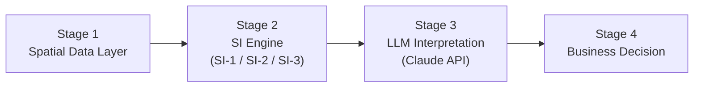

# Pipeline Architecture Spec: Spatial Intelligence for Business


---

## 1. Overview

The pipeline turns raw spatial data into a plain-English business recommendation in four stages. Each of the three research tracks (SI-1, SI-2, SI-3) plugs into the same pipeline, so they all produce outputs in the same format.



| Stage | What happens | Who owns it |
|---|---|---|
| 1. Spatial data layer | Collect, clean, and store public spatial and business data | Each track (shared helpers: Abdullah) |
| 2. SI engine | Run the analysis that answers the track's question | Stella (SI-1), Sushma (SI-2), Glira (SI-3) |
| 3. LLM interpretation | Turn analysis results into a structured narrative | Abdullah |
| 4. Business decision | Present the finding in the standard report format | Arezou (template), Abdullah (generation) |

---

## 2. Stage 1: Spatial Data Layer

**Sources**
- U.S. Census Bureau (ACS, TIGER boundaries)
- OpenStreetMap (via OSMnx)
- Google Places
- Esri Living Atlas

**Conventions (proposed)**
- Spatial data is held as GeoPandas GeoDataFrames.
- Store in **EPSG:4326** (lat/lon). Convert to **EPSG:3310** (California Albers) for distance and area calculations.
- Census tract GEOID is the standard join key, kept as a string to preserve leading zeros.
- Raw and intermediate data lives in `/data` (gitignored). Code to fetch it lives in each track's folder.
- API keys live in `.env` and are never committed.

---

## 3. Stage 2: SI Engine

Each track is a Python module that exposes one function returning a **standard result dictionary**. This is the contract between the tracks and the shared pipeline.

| Track | Question | Pilot area | Method notes |
|---|---|---|---|
| SI-1 Location Intelligence | Where should we open our next location? | Coastal LA/OC vs. inland San Bernardino | SCEW (zone-specific weights) |
| SI-2 Market Gap Intelligence | Which markets are we underserving? | South LA (between the 10, 110, and 105) | Underservice index |
| SI-3 Territory Intelligence | How should we structure service or delivery zones? | Pomona, Claremont, La Verne, Walnut, Diamond Bar, West Covina | Clustering + optimization (scikit-learn, PuLP) |

**Standard result dictionary**

```python
{
    "track": "SI-1",                       # SI-1, SI-2, or SI-3
    "question": "Where should we open our next location?",
    "study_area": "Coastal LA/OC vs Inland San Bernardino",
    "method": "SCEW",
    "key_metrics": {"candidate_sites": 42, "top_score": 0.87},
    "top_results": [                       # max ~10 rows, already ranked
        {"id": "06037xxxxx", "name": "Tract A", "score": 0.87}
    ],
    "geojson_path": "data/out/si1_results.geojson",
    "caveats": ["Census data is 5-year estimates", "Retail data is incomplete"]
}
```

**Rules**
- Keep `top_results` short. The LLM gets summaries, not full datasets.
- Put every known limitation in `caveats`. The LLM uses these for the confidence note.
- Maps and figures are saved as files, and the path is passed along.

---

## 4. Stage 3: LLM Interpretation

**Flow:** result dict → prompt template → Claude API → validated JSON.

- Implemented in `shared_pipeline/llm.py` using LangChain and the Anthropic API.
- The prompt tells Claude to use **only** the numbers provided and not to invent data.
- Claude returns JSON matching the Stage 4 schema. The code strips code fences and validates the keys.
- Temperature is 0 for repeatability. The model is set by `CLAUDE_MODEL` in `.env`.
- Every call (prompt, response, model, timestamp) is logged to a file so Arezou can use it in the evaluation study.

**Interface for the tracks**

```python
from shared_pipeline.llm import interpret

narrative = interpret(result_dict)   # returns the Stage 4 dict
```

**Guardrails to discuss**
- Retry once if the response is not valid JSON.
- Check that numbers in the narrative appear in the input.
- Decide what to do if the API is down (fail loudly vs. fallback text).

---

## 5. Stage 4: Business Decision

The output matches the report template Arezou is drafting, so all three tracks read consistently.

```json
{
  "question": "",
  "key_finding": "",
  "map_visual": "path to map or short description",
  "business_recommendation": "",
  "confidence_note": ""
}
```

Delivery formats under consideration: Plotly Dash dashboard, Power BI report, and static HTML/PDF export.

---

## 6. Repository Layout

```
/si1               SI-1 module (Stella)
/si2               SI-2 module (Sushma)
/si3               SI-3 module (Glira)
/shared_pipeline   LLM scaffold and shared helpers (Abdullah)
/data              Local data, gitignored
/docs              Specs, report template, evaluation instrument
```

**Workflow:** one branch per track, pull requests into `main`, no secrets or data in git.

---

## 7. Timeline (proposed, to confirm with Dr. Koohikamali)

| Phase | Goal |
|---|---|
| Month 1 | Repo, environments, API access, result-dict contract agreed |
| Months 2-3 | Each track produces a first working result for its pilot area |
| Month 4 | All three tracks run end-to-end through the LLM stage |
| Month 5 | Dashboards and report template applied to all tracks |
| Month 6 | Pilot the decision-confidence evaluation (Arezou) |
| Months 7-8 | Analysis, manuscript writing, symposium preparation |

---

## 8. Open Questions for the Meeting

1. Do Stella, Sushma, and Glira agree with the result-dictionary fields, or what needs to change?
2. Who pays for Claude API usage, and what is the budget?
3. Which model(s) do we use, and do we compare more than one for the evaluation?
4. Do we log every LLM call for the study, and is that allowed under any ethics or data requirements?
5. Dashboard tool: Plotly Dash, Power BI, or both?
6. Is Google Places usage covered by a key and budget, and who holds it?
7. Does Glira need setup help with scikit-learn and PuLP before the pilot work starts?

---

## 9. Risks

- **Interface drift:** tracks change their output format late. Mitigation: agree on the result dict now.
- **LLM hallucination:** narratives cite numbers not in the data. Mitigation: strict prompt plus number checking.
- **API cost or rate limits:** Mitigation: send summaries only and cache responses.
- **Data licensing:** Google Places and Esri have usage terms. Mitigation: confirm with Dr. Koohikamali.
